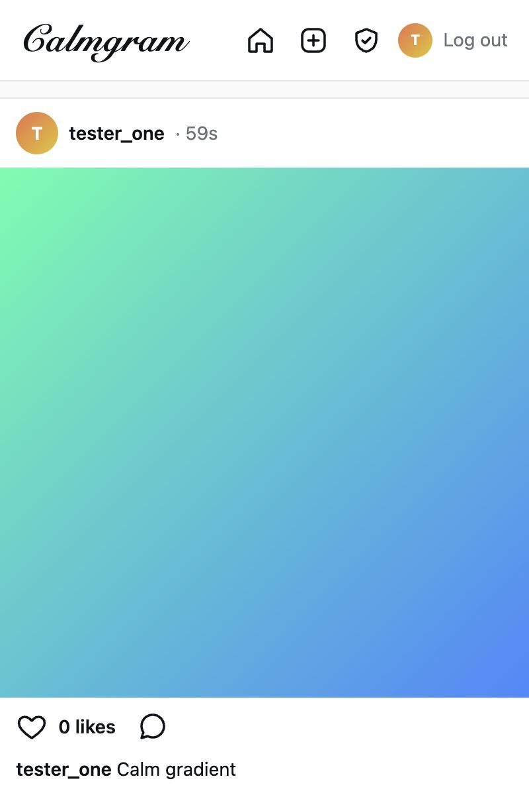
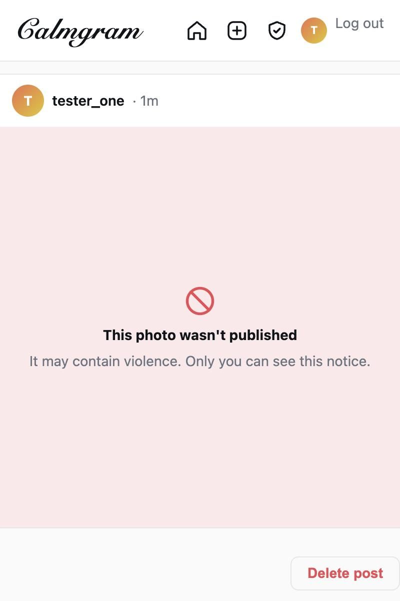
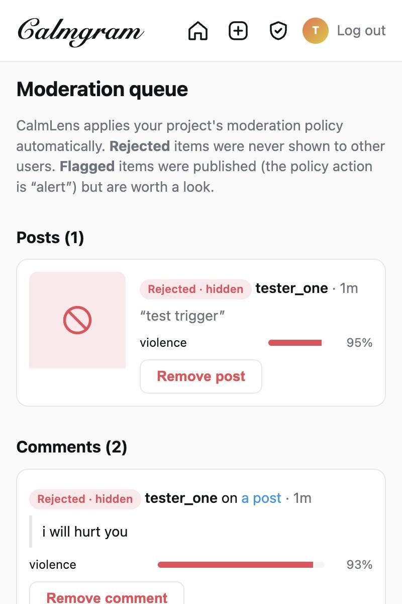

# Calmgram

An Instagram-style photo app that shows how to add content moderation to a real product with
[CalmLens](https://calmlens.com). Every photo, caption, comment and bio is checked before other
people can see it.

| Feed | Blocked upload (author's view) | Moderation queue |
| --- | --- | --- |
|  |  |  |

- **Photos** go straight from the browser to CalmLens through an
  [upload preset](https://calmlens.com/docs/guides/upload-presets), with a single-use token the
  server signs. They stay private to their author while they're checked, then appear in the feed,
  served and resized by the CalmLens CDN.
- **Sensitive media:** photos CalmLens age-restricts are published, but shown only to visitors who
  turn on **Show sensitive media** on their profile (an over-18 confirmation that stands in for a
  real age check). Everyone else, including signed-out visitors, sees the photo's blurred
  placeholder with a "Sensitive content" notice.
- **Captions, comments and bios** are checked before they're saved. Text that isn't allowed is
  never shown, and the author is told why.
- **Your own posts that aren't published** stay in your feed, visible only to you: "Checking your
  photo…" while CalmLens decides, the category behind a block, or **Try again** when processing
  failed (`assets.retry`).
- The **moderation queue** lists every photo and comment with its moderation status and category
  scores, grouped into those still being checked, those the policy flagged (limited,
  age-restricted, blocked, purged or failed) and those allowed.

Try it at **[example.calmlens.com](https://example.calmlens.com)**. It's a single Cloudflare Worker
([Hono](https://hono.dev), server-rendered HTML, Workers KV, styled with [Tailwind CSS](https://tailwindcss.com)) with two small browser scripts: one for photo uploads, and one that asks before deletes in a native `<dialog>`. Every form also works without JavaScript. It uses Bun, TypeScript 7 and Biome (`bun run check`).

It runs in two modes:

| Mode | When | Moderation |
| --- | --- | --- |
| **Demo** | `CALMLENS_DEMO=1` (`bun run dev:demo`) | Simulated locally, so you can click around in 30 seconds |
| **Live** | `CALMLENS_API_KEY` + `CALMLENS_PROJECT_ID` set | Real CalmLens moderation and CDN. Add `CALMLENS_UPLOAD_PRESET_ID` for browser uploads |

Missing keys never switch demo mode on by themselves: without keys and without `CALMLENS_DEMO=1`,
Calmgram answers every request with `503` instead of publishing unmoderated content. Demo mode
also only serves `localhost` unless you set `CALMLENS_DEMO_ALLOW_REMOTE=1`.

## Quick start (demo mode)

This example links to `@calmlens/sdk` in the repo, and the browser upload script is bundled from
that build: no published release includes `CalmLensAppClient` yet. Once one does, depend on
the published `@calmlens/sdk` instead of `link:@calmlens/sdk`. From the repo root, install
dependencies, build the SDK and register it with `bun link` first:

```bash
(cd javascript && bun install && bun run build && bun link)
cd examples/calmgram
bun install
bun run dev:demo --port 6400
```

Open http://localhost:6400 (you're given a random username straight away; change it from your profile) and try:

- commenting `i will hurt you` (blocked) or a [test code](#testing-moderation-safely);
- uploading one of the test images from the **New post** page (the sexual one is age-restricted,
  the others blocked) or any normal photo (allowed after ~2 seconds);
- turning on **Show sensitive media** on your profile to see the age-restricted photo instead of
  its blurred placeholder, and off again;
- the CalmLens moderation panel: beside the feed on wide screens, and in the corner on narrower
  ones (collapsed to start with on phones). Click its header to collapse or reopen it.

Demo mode is a stand-in, not a moderation model. Use live mode to see real decisions.

## Live mode

1. Create a CalmLens account and open the portal.
2. **API key:** Developer → API Keys → create a key. Calmgram reads, creates, updates (retrying
   failed photos), deletes and shares assets, and writes lenses.
3. **Project ID:** open the project selector, choose **Edit** on your project, and copy the
   Project ID.
4. **Policy:** Moderation Policies → pick a preset (*General community* suits most social apps).
5. **Upload preset:** Developer → Upload presets → create one for post photos (see
   [below](#upload-preset)) and copy its ID.
6. Copy `.dev.vars.example` to `.dev.vars` and fill in the key, project ID and upload preset ID.
7. `bun run dev --port 6400`. The demo banner disappears when live mode is on.

### Upload preset

With `CALMLENS_UPLOAD_PRESET_ID` set, the browser uploads photos straight to CalmLens instead of
posting them to the Worker. Create the preset with these settings:

| Setting | Value |
| --- | --- |
| Who can upload | **Users your server approves**, so every upload needs a token Calmgram signed |
| File types | `image/jpeg`, `image/png`, `image/webp`, `image/gif`, `image/heic` |
| Maximum file size | 10 MB |
| Visibility | **Public**, so allowed photos, opted-in age-restricted photos and placeholders can be served from the CDN (Calmgram never builds a content URL for anything else) |
| Keep content after moderation | On, so allowed photos can be served and resized by the CDN |
| Read text in images | On, to catch harmful text in screenshots and memes |
| Show the decision to the uploader | Off. Calmgram's server reads the decision, not the browser |
| Allowed sites | Your app's origins, such as `http://localhost:6400` and `https://<your-app>` |

Over the API, the two switches are the preset's `processingOptions`:
`{ keepContentAfterProcessing: true, features: { ocr: { enabled: true } } }`. The no-JavaScript
form post also uploads through the preset from the server, so both paths follow the same rules. Without `CALMLENS_UPLOAD_PRESET_ID`, every photo is posted to the Worker and
forwarded to CalmLens, as in demo mode.

### Trying sensitive media

With the *General community* policy, adult sexual content is age-restricted. Download the sexual
test image from **New post** (with `CALMLENS_TEST_INPUT_KEY` set) and share it: once CalmLens
age-restricts it, the post appears in the feed behind its blurred placeholder. Turn on **Show
sensitive media** on your profile to see the photo itself. Subscribe the webhook to
`asset.age-restricted` (below) so the post updates as soon as CalmLens decides.

To try it against a CalmLens instance running locally from this repository, set
`CALMLENS_API_URL=http://localhost:6110/v1` and `CALMLENS_CDN_URL=http://localhost:6130/v1` in
`.dev.vars`, with an API key and project ID from your local portal. Webhooks reach a
local app through `calmlens listen` (below).

### Webhooks (recommended)

CalmLens tells your app when an image has been checked. In the portal, go to **Webhooks**, add
`https://<your-app>/api/webhooks/calmlens`, subscribe to `asset.allowed`, `asset.limited`, `asset.age-restricted`, `asset.blocked`, `asset.purged` and
`asset.failed` (the status events are sent for automated decisions and for reviewer decisions made
in the portal), and put the secret in
`CALMLENS_WEBHOOK_SECRET`. The handler reads the asset ID from the delivery's `data.assetId`.

For local development, forward events to the dev server with the SDK's CLI. It signs each event
with your `CALMLENS_WEBHOOK_SECRET`, so the handler's signature check works unchanged:

```bash
bunx calmlens listen --forward-to http://localhost:6400/api/webhooks/calmlens --env-file .dev.vars
```

Without webhooks the app still works: pages showing a pending post poll CalmLens for its status.
CalmLens retries failed deliveries for about 20 hours, but Calmgram keeps polling as a fallback
for anything still pending.

## How it works

```
                 ┌────────────── text: caption, comment, bio ───────────────┐
 user ──► Calmgram server ──► client.text.classify({ text })                 (waits)
                 │                 └─► allowed → save · otherwise → tell the user why
                 │
                 └────────────── photo: the browser uploads, the server checks ────┐
  1. browser ──► POST /api/uploads ──► server checks the user,
                                       client.uploadTokens.sign({ uploadPresetId,
                                         externalId: "post-<id>" })      (local, no request)
  2. browser ──► new CalmLensAppClient({ uploadPresetId, token })
                 .assets.create({ content: { data: file } }) ──► CalmLens (returns undecided)
  3. browser ──► POST /posts { postId, assetId, caption }
                 server: assets.retrieve(assetId) must have externalId "post-<id>" and
                 come through the preset · classify the caption · save post as pending
                            ▲                               │
      webhook: asset.allowed, asset.blocked, …   or poll: assets.retrieve
                            └──────── allowed, limited → show in feed via CDN lens URL
                                      age-restricted → show in feed: the lens URL with
                                        ageConfirmed=true if the viewer opted in, otherwise
                                        the /placeholder image and a notice
                                      blocked, purged → author sees "not published" notice
```

Without JavaScript, or without an upload preset, the form posts the photo to the server instead,
which checks the caption and forwards the photo with `client.assets.create`. The rest is the same.

CalmLens's **moderation policy** (set in the portal) turns each report into a moderation status,
and a reviewer can change it later. The app only needs one field:

| `classification.moderation.status` | Calmgram does |
| --- | --- |
| `allowed` | Publish |
| `limited` | Publish, like `allowed`. The CDN serves it on the plain URL; the status only marks it so an app can reduce its reach, for example by keeping it out of recommendations |
| `age-restricted` | Publish behind a placeholder. The CDN refuses the plain URL, so viewers who turned on **Show sensitive media** get the URL with `ageConfirmed=true`; everyone else, including signed-out visitors and the author with the setting off, gets the asset's blurred `/placeholder` image and a "Sensitive content" notice. The author also sees the status |
| `blocked` | Don't publish; tell the author which category matched (from `classification.moderation`) |
| `purged` | As `blocked`. CalmLens has also deleted the stored content |
| `pending` | Show only to the author with a "Checking…" placeholder |

When `classification.status` is `failed`, Calmgram doesn't publish and offers the author **Try
again**, which calls `assets.retry` (the API key needs the `assets:update` permission for this).

Text has no sensitive view: a caption, comment or bio that comes back `age-restricted` is refused
like any other text that isn't `allowed` or `limited`.

### Where to look

| File | What it shows |
| --- | --- |
| [`src/moderation/calmlens.ts`](src/moderation/calmlens.ts) | Every server-side CalmLens call: text, images, upload tokens, lenses, CDN URLs, deletion, webhook verification |
| [`browser/upload.ts`](browser/upload.ts) | The browser upload: fetch a token, upload through the preset, submit the asset ID. Bundled to `public/upload.js` by `bun run build:client`, which `wrangler dev` and `wrangler deploy` run for you |
| [`browser/confirm.ts`](browser/confirm.ts) | The native `<dialog>` that asks before deleting a post or starting over, bundled to `public/confirm.js` |
| [`src/content.ts`](src/content.ts) | App logic: when to block, when to queue, checking a browser upload, the polling fallback |
| [`src/index.tsx`](src/index.tsx) | Routes, including the upload token endpoint, the webhook handler (signature check on the raw body, idempotent by event ID) and the moderation queue |
| [`src/sandbox.ts`](src/sandbox.ts) | The public demo's per-visitor storage and 24-hour cleanup |
| [`src/budget.ts`](src/budget.ts) | The public demo's daily CalmLens budget |
| [`src/moderation/demo.ts`](src/moderation/demo.ts) | The demo-mode simulator, including its stand-ins for the CDN's `ageConfirmed=true` opt-in and blurred `/placeholder` image |

### Things worth copying

- **Text is checked synchronously, images asynchronously.** Text is fast to classify, so the user
  gets an immediate answer. Images are queued so uploads return quickly.
- **The browser uploads, the server checks.** Photos never pass through the Worker, and the
  browser never sees an API key: it gets a single-use upload token for one photo. The token sets
  the asset's `externalId` to the post it was signed for, so when the browser submits an asset ID,
  the server fetches that asset and accepts it only if the `externalId` and upload preset match.
  The browser's word never publishes anything; only a CalmLens decision does.
- **The no-JavaScript fallback checks the caption before uploading**, so a bad caption fails fast.
  With browser uploads, a caption that isn't allowed deletes the photo that was just uploaded.
- **CDN URLs are only built for published images.** The CalmLens CDN serves public assets while
  they are still pending, so Calmgram never sends an image URL to a browser until CalmLens has
  allowed or age-restricted it, and it uses CalmLens's random asset ID in URLs rather than its own
  (guessable) post IDs.
- **Age-restricted photos opt in on the URL** (`cdn.getAssetUrl({ ..., ageConfirmed: true })`),
  and only for viewers whose setting allows it (`postMediaFor` in `src/content.ts`). An opted-in
  URL works for anyone who has it, so if you need CalmLens itself to refuse everyone else, issue
  short-lived signed URLs from your backend instead (see
  [Age-restricted assets](https://calmlens.com/docs/guides/delivering-assets#age-restricted-assets)).
- **`not-evaluated` is not zero.** Only `evaluated` and `partial` category results have scores.
- **Lenses** are named, versioned image presets. Calmgram defines `calmgram-feed` (1080px WebP)
  and `calmgram-thumb` (400px square) once with `ensureLenses`, so it needs no image-resizing code.
- **Deleting a post deletes the image from CalmLens** with `assets.delete`, because CalmLens holds
  the only copy.
- **Decisions are tied back to the record they belong to.** A webhook or poll only updates a post or
  comment when the asset's `externalId` matches the one Calmgram created it with.
- **Retries are safe.** The SDK retries network failures and throttling with an idempotency key,
  so a retried upload never creates a second asset.

## Testing moderation safely

CalmLens recognises special test inputs, so you can test your "post removed" flow without uploading
real harmful content.

Every test input contains an authentication tag generated with your project's secret **test input key**, available under **Assets → Try it → Test inputs** in the portal. Tags are specific to the category and content type and do not disclose the key. A valid sample can still be reused in the same project while test inputs are enabled. Demo mode uses the public key `1a2b3c4d1a2b3c4d1a2b3c4d1a2b3c4d`.

- **Images:** download them from **New post**. A compact square grid encodes the complete authenticated test input. Upload it unchanged. Download new files after changing projects. `bun run test-images` regenerates simulator fixtures; set `CALMLENS_TEST_INPUT_KEY` to generate them for a real project.
- **Text:** copy an authenticated category code from the portal into a comment. All eight moderation categories are supported. `bun run test-images` prints the exact codes, and **New post** shows one when `CALMLENS_TEST_INPUT_KEY` is set.

## The public demo

Calmgram is built to be deployed as a shared public demo, so each visitor gets a **private
sandbox**, created on their first visit with a random username (no sign-up; crawlers don't get
one). A session cookie keys one KV value holding their username, posts, comments, likes and
bio. Nobody sees anyone else's uploads or text that wasn't allowed, and the moderation queue shows shared illustrative examples alongside the
visitor's own content. Everyone shares a read-only example feed, rendered from the same fixed list as the landing page. These examples are never uploaded to CalmLens.

An hourly cron deletes each sandbox 24 hours after its last use, along with its images and text
records on CalmLens. Because every visitor shares one CalmLens API key, Calmgram limits what anyone
can spend:

- uploads are capped at 20 per sandbox, and upload tokens are only signed below that cap;
- form submissions and upload token requests are rate limited per IP address (20 a minute, the `WRITE_LIMITER` Workers Rate
  Limiting binding in `wrangler.jsonc`);
- sandboxes are only created by page views, never by a form submission without a session cookie;
- all visitors together get a daily CalmLens budget (`CALMGRAM_DAILY_MODERATION_LIMIT`, default
  2000 calls a day, counted in KV);
- with `TURNSTILE_SITE_KEY` and `TURNSTILE_SECRET_KEY` set, visitors pass a
  [Turnstile](https://developers.cloudflare.com/turnstile/) check before any page loads, so
  crawlers never reach the app (CalmLens webhook deliveries skip it). Without the keys, as in
  local development, there is no check.

To deploy your own:

```bash
bunx wrangler kv namespace create CALMGRAM   # put the id in wrangler.jsonc
bunx wrangler secret put CALMLENS_API_KEY
bunx wrangler secret put CALMLENS_PROJECT_ID
bunx wrangler secret put CALMLENS_WEBHOOK_SECRET
bunx wrangler secret put CALMLENS_UPLOAD_PRESET_ID   # optional, enables browser uploads
bunx wrangler secret put TURNSTILE_SITE_KEY          # optional, with the secret key below
bunx wrangler secret put TURNSTILE_SECRET_KEY        # enables the Turnstile check
bun run deploy
```

Add your deployed origin to the upload preset's allowed sites.

The hosted CalmLens demo is deployed separately. This repository's Wrangler configuration is
a template for your own deployment; replace the KV namespace placeholder before deploying.

## Before you ship something like this

- Replace the per-visitor KV sandbox and automatic random accounts with your real database and auth.
- Protect `/moderation` with admin auth.
- Check your real user, and what they may post, in the upload token endpoint (`POST /api/uploads`).
- Clean up uploads that were never submitted as a post: a token is signed for a post ID, so you
  can list assets in the preset's folder whose `externalId` never became a post and delete them.
- Pick and review your CalmLens moderation policy, and decide how users can appeal decisions.
- CalmLens's general sexual-content moderation doesn't estimate age or detect CSAM. Platforms that
  host user images usually need a dedicated hash-matching service as well.

## License

MIT

The test-input presets, grid encoding and authenticated decoding come
from `@calmlens/sdk/test-inputs`, also used by CalmLens itself. Calmgram only
encodes/decodes PNG files and supplies the simulator's demo key. When developing
against this repository, rebuild `javascript` after changing the shared
test-input helpers.

Links to `/new?caption=...` prefill the new post caption (up to 2,200 characters). The visitor can edit it and choose a photo before sharing. A draft retained after a failed submission takes precedence.

The landing page and Calmgram use `packages/shared/src/ModerationExamplePosts.ts` as their fixed example list. These fictional posts and their illustrative decisions are available immediately: the feed shows the example photographs, and the moderation queue also lists the image and text examples, including blocked ones, which it names by their description without showing their content. They are never seeded into KV or uploaded to CalmLens, and incur no moderation usage. Visitor-created posts remain isolated to their sandbox and use the configured moderation provider.
