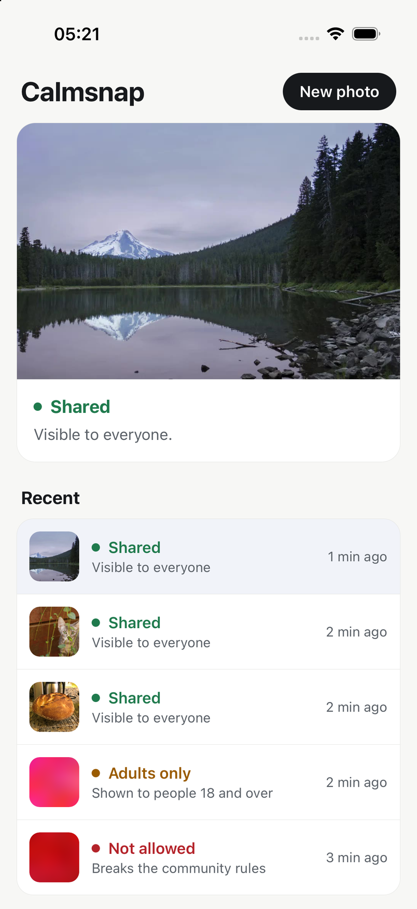

# Calmsnap

An Expo (React Native) app that uploads photos straight from the phone to CalmLens through an
[upload preset](https://calmlens.com/docs/guides/upload-presets), then shows the decision. The app
never holds an API key: a tiny token server signs a single-use upload token for each upload.



## How it works

```text
 Phone (Expo app)                     Your token server (server/index.ts)
 ────────────────                     ──────────────────────────────────
 1. Pick a photo
 2. POST /upload-token  ───────────►  client.uploadTokens.sign({ uploadPresetId, externalId })
                        ◄───────────  { token, expiresAt }   (signed locally, no CalmLens request)
 3. Upload  ── Authorization: Bearer <token> ──►  CalmLens
            ◄── { id, status: "pending" } ──────
 4. Check the upload with the same token until the status is no longer "pending"
```

- [`server/index.ts`](server/index.ts) holds the API key and returns a new token on
  `POST /upload-token`. A real app checks who is signed in before signing, and can pass an
  `externalId` (such as a post ID) that the uploaded asset gets.
- [`App.tsx`](App.tsx) runs the uploads with `useCalmLensUpload` from
  `@calmlens/sdk/react-native`, the same upload queue the SDK's `CalmLensUploader` is built on,
  and draws its own screens from the queue's items. The queue fetches a new token for each
  upload, sends the photo, and checks it with the same token until CalmLens decides. Photos are
  checked after they're stored, so the first answer is usually `pending`; the app shows
  **Checking photo** meanwhile. After a minute the queue stops and the app offers **Check
  again**. You can keep sharing while a photo is checked, and **Recent** lists every upload this
  session with its state. Tap one to show it again.
- [`src/calmlens.ts`](src/calmlens.ts) holds the queue's settings (the upload preset, the token
  function and how long to check) and picks photos with `expo-image-picker`. Each picked photo is
  a file the queue can upload: its name, type and size, plus `arrayBuffer()`, which reads the
  bytes with `expo-file-system` when the upload starts.
- How each decision is shown is in [`src/uploads.ts`](src/uploads.ts): `allowed` and `limited`
  photos are **Shared** (`limited` ones are only marked so your app can reduce their reach, such
  as keeping them out of recommendations), `age-restricted` photos are **Adults only** and stay
  blurred until the person shares an age range of 18 or older (see
  [Age-restricted photos](#age-restricted-photos)), and `blocked` and `purged` photos are
  **Not allowed** and stay blurred. The upload preset only returns the status to the app, never
  the report, so the app gives a general reason.
- Errors show a message for the person using the app and the error code for you, with
  **Try again**. The app handles every `upload-preset/*` and `upload-token/*` code, timeouts,
  network errors and an unreachable token server. Trying again uploads the photo again only when
  the upload never finished; otherwise the queue checks the existing upload.

For a ready-made pick button and file list instead of your own screens, render
`CalmLensUploader` from `@calmlens/sdk/react-native` with the same settings and a `pick`
function, such as `pickPhoto` here.

## Age-restricted photos

When CalmLens marks a photo `age-restricted`, the app blurs it and offers **Share my age range**.
[`src/ageCheck.ts`](src/ageCheck.ts) loads `expo-age-range` on first use, so the app still runs
in Expo Go, which doesn't include that native module (there the check answers that the device
can't share an age range). It asks the phone's OS with
[`expo-age-range`](https://docs.expo.dev/versions/v57.0.0/sdk/age-range/):

- **iOS 26+** uses Apple's Declared Age Range. The OS shows its own sheet, and the app learns
  only whether the person is above or below the age gate it asks about (18).
- **Android** uses Google Play Age Signals. `requestAgeSignalsAccessAsync` shows Play's consent
  screen first, and `requestAgeRangeAsync` returns a range only after the person agrees.

[Check age natively](https://calmlens.com/docs/guides/native-age-checks) covers the same checks in Swift, Kotlin and on the web.

The app never sees a birth date. If the person shares a range that starts at 18 or older, the
photo is shown; if they decline, are under 18, or the device can't answer, it stays hidden. The
answer is kept for the session, so the person is asked once.

Below iOS 26 and on the web, `expo-age-range` answers as if the person were an adult. The example
treats those devices as unable to answer instead, so the photo stays hidden.

An age range can be self-declared. `requestAgeCheck` reports `confirmed: true` when Apple
confirmed it (`ageRangeDeclaration: "confirmed"`) or Google checked it with a card, ID, selfie or
digital ID (`ageRangeSource` `TIER_C` or `TIER_D`). Require that where the law asks for a verified
age.

This app shows the photo from the phone itself. To show other people's age-restricted uploads
from the CDN once the check passes, build the URL with `getAssetUrl({ ..., ageConfirmed: true })`;
the CDN refuses age-restricted assets on plain public URLs. If CalmLens itself must refuse everyone
your server hasn't approved, have your server return
[signed URLs](https://calmlens.com/docs/guides/delivering-assets#age-restricted-assets) instead.

The iOS age range needs the `com.apple.developer.declared-age-range` entitlement, which
[`app.json`](app.json) sets, and a real device signed in to an Apple Account. Simulators may not
answer. On Android, Play Age Signals needs Google Play on the device and only returns a range
where Google provides age signals.

The preset decides the folder, visibility and accepted file types, so the app can only name its
upload. HEIC photos arrive as JPEG; JPEG and PNG files are uploaded unchanged.

## Set up a preset for a mobile app

In the portal, open **Developer → Upload presets** and create a preset with:

| Setting                           | Value                                                                                                                                   |
| --------------------------------- | --------------------------------------------------------------------------------------------------------------------------------------- |
| Who can upload?                   | **Users your server approves** (requires a token)                                                                                       |
| File types                        | `image/*`                                                                                                                               |
| Show the decision to the uploader | On, so the app can show the moderation status                                                                                           |
| Allowed sites                     | **Leave empty.** Mobile apps send no `Origin` header, so a preset that lists sites refuses them with `upload-preset/origin-not-allowed` |

The token is what keeps strangers out: anyone can read the preset ID from the app, but only your
server can sign tokens for it.

Then create an API key in **Developer → API Keys** that can create assets in the preset's folder.

## Run it

You need [Bun](https://bun.sh), Xcode with an iOS Simulator (or the Expo Go app on a phone) and
this repo.

This example links to `@calmlens/sdk` in the repo: the React Native support it needs isn't in a
published release yet. Once it is, depend on the published `@calmlens/sdk` instead of
`file:../../javascript`. From the repo root:

```bash
(cd javascript && bun install && bun run build)
cd examples/mobile-uploads-expo
bun install
```

Create `.env.local` in this folder:

```bash
# Token server only. Never prefix these with EXPO_PUBLIC_: those values are built into the app.
CALMLENS_API_KEY=clsk_...
CALMLENS_PROJECT_ID=proj_8fK2mQx7Lp4NvB3tRz9Y
CALMLENS_UPLOAD_PRESET_ID=preset_4Lk8Qw2Xm9Rt5Vb3Nc7P

# The app
EXPO_PUBLIC_CALMLENS_UPLOAD_PRESET_ID=preset_4Lk8Qw2Xm9Rt5Vb3Nc7P
```

Run the tests for the upload states with `bun test`, and type-check with `bun run check`.

Start the token server in one terminal:

```bash
bun run server
```

Start the app in another, and press `i` to open it in the iOS Simulator with Expo Go:

```bash
bun run start
```

Choose a photo. Normal photos come back `allowed`; to see one that isn't, upload a
[test image](https://calmlens.com/docs/guides/testing). Test images carry your project's secret
test input key, so download the violence one from **Assets → Try test inputs** in your project
(the local backend below writes one for its project instead). Add it to the simulator's photo
library with:

```bash
xcrun simctl addmedia booted ~/Downloads/calmlens-test-violence.png
```

### On a phone or Android emulator

The app reaches the token server at `http://127.0.0.1:6411/upload-token`, which only works in the
iOS Simulator. For a phone on the same network, start the server on every interface and point
the app at your computer's address:

```bash
HOST=0.0.0.0 bun run server
```

```bash
# .env.local
EXPO_PUBLIC_TOKEN_SERVER_URL=http://192.168.1.20:6411/upload-token
```

Android emulators reach your computer at `10.0.2.2` instead of `127.0.0.1`. Restart Expo after
changing `.env.local`.

## Files

| File                                 | What it does                                                                       |
| ------------------------------------ | ---------------------------------------------------------------------------------- |
| [`App.tsx`](App.tsx)                 | Picker, upload, polling, the photo card, recent uploads and the age gate           |
| [`src/uploads.ts`](src/uploads.ts)   | Each upload's state and how its decision is shown, tested in `src/uploads.test.ts` |
| [`src/ageCheck.ts`](src/ageCheck.ts) | Asks iOS or Android for the person's age range, with their consent                 |
| [`src/calmlens.ts`](src/calmlens.ts) | The upload preset client, token fetching and error messages                        |
| [`server/index.ts`](server/index.ts) | Token server: signs one upload token per request                                   |
| [`metro.config.js`](metro.config.js) | Lets Metro bundle the SDK linked from `javascript`                                 |

This is an example, not a production app: the token server signs a token for anyone who asks.
Put it behind your sign-in, and limit how many tokens one user can get.
