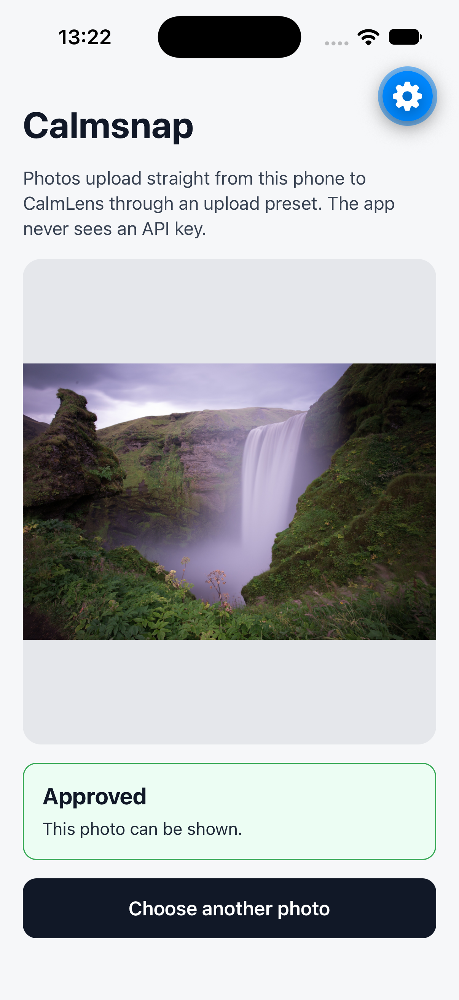
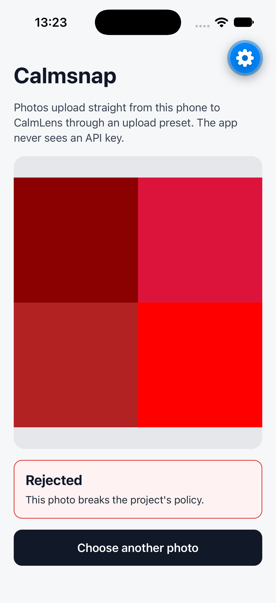

# Calmsnap

An Expo (React Native) app that uploads photos straight from the phone to CalmLens through an
[upload preset](https://calmlens.com/docs/guides/upload-presets), then shows the decision. The app
never holds an API key: a tiny token server signs a single-use upload token for each upload.

| Allowed | Blocked |
| --- | --- |
|  |  |

## How it works

```text
 Phone (Expo app)                     Your token server (server/index.ts)
 ────────────────                     ──────────────────────────────────
 1. Pick a photo
 2. POST /upload-token  ───────────►  client.uploadTokens.sign({ uploadPresetId, externalId })
                        ◄───────────  { token, expiresAt }   (signed locally, no CalmLens request)
 3. assets.classify()  ── Authorization: Bearer <token> ──►  CalmLens
                       ◄── { id, status: "pending" } ──────
 4. assets.retrieve() every 1.5 s until the status is no longer "pending"
```

- [`server/index.ts`](server/index.ts) holds the API key and returns a new token on
  `POST /upload-token`. A real app checks who is signed in before signing, and can pass an
  `externalId` (such as a post ID) that the uploaded asset gets.
- [`src/calmlens.ts`](src/calmlens.ts) creates the client with
  `new CalmLensAppClient({ uploadPresetId, token })`. The `token` function fetches a new token for
  each upload, and `assets.retrieve` reuses the token the upload started with.
- [`App.tsx`](App.tsx) picks a photo with `expo-image-picker`, reads it with `expo-file-system`
  and uploads it with `assets.classify`. Photos are checked after they're stored, so the first
  answer is usually `pending`; the app shows **Still checking** and polls `assets.retrieve`
  until CalmLens decides. After 60 seconds it stops and offers **Check again**. Only `allowed`
  photos can be shown. The app has no age check, so it treats `age-restricted` like `blocked` and
  `purged`: not shown.
- Errors show a message for the person using the app and the error code for you. The app handles
  every `upload-preset/*` and `upload-token/*` code, timeouts, network errors and an unreachable
  token server.

The preset decides the folder, visibility and accepted file types, so the app can only name its
upload. HEIC photos arrive as JPEG; JPEG and PNG files are uploaded unchanged.

## Set up a preset for a mobile app

In the portal, open **Developer → Upload presets** and create a preset with:

| Setting | Value |
| --- | --- |
| Who can upload? | **Users your server approves** (requires a token) |
| File types | `image/*` |
| Show the decision to the uploader | On, so the app can show the moderation status |
| Allowed sites | **Leave empty.** Mobile apps send no `Origin` header, so a preset that lists sites refuses them with `upload-preset/origin-not-allowed` |

The token is what keeps strangers out: anyone can read the preset ID from the app, but only your
server can sign tokens for it.

Then create an API key in **Developer → API Keys** that can create assets in the preset's folder.

## Run it

You need [Bun](https://bun.sh), Xcode with an iOS Simulator (or the Expo Go app on a phone) and
this repo.

This example links to `@calmlens/sdk` in the repo: the React Native support it needs isn't in a
published release yet. Once it is, depend on the published `@calmlens/sdk` instead of
`link:@calmlens/sdk`. From the repo root:

```bash
(cd javascript && bun install)
cd examples/mobile-uploads-expo
bun install
```

Create `.env.local` in this folder:

```bash
# Token server only. Never prefix these with EXPO_PUBLIC_: those values are built into the app.
CALMLENS_API_KEY=clsk_...
CALMLENS_PROJECT_ID=your-project-id
CALMLENS_UPLOAD_PRESET_ID=your-upload-preset-id

# The app
EXPO_PUBLIC_CALMLENS_UPLOAD_PRESET_ID=your-upload-preset-id
```

Start the token server in one terminal:

```bash
bun run server
```

Start the app in another, and press `i` to open it in the iOS Simulator with Expo Go:

```bash
bun run start
```

Choose a photo. Normal photos come back `allowed`; to see one that isn't, upload a
[test image](https://calmlens.com/docs/guides/testing). Test images carry your project's secret
test input key, so download the violence one from **Assets → Try test inputs** in your project
(the local backend below writes one for its project instead). Add it to the simulator's photo
library with:

```bash
xcrun simctl addmedia booted ~/Downloads/calmlens-test-violence.png
```

### On a phone or Android emulator

The app reaches the token server at `http://127.0.0.1:6411/upload-token`, which only works in the
iOS Simulator. For a phone on the same network, start the server on every interface and point
the app at your computer's address:

```bash
HOST=0.0.0.0 bun run server
```

```bash
# .env.local
EXPO_PUBLIC_TOKEN_SERVER_URL=http://192.168.1.20:6411/upload-token
```

Android emulators reach your computer at `10.0.2.2` instead of `127.0.0.1`. Restart Expo after
changing `.env.local`.

## Files

| File | What it does |
| --- | --- |
| [`App.tsx`](App.tsx) | Picker, upload, polling and the result card |
| [`src/calmlens.ts`](src/calmlens.ts) | The upload preset client, token fetching and error messages |
| [`server/index.ts`](server/index.ts) | Token server: signs one upload token per request |
| [`metro.config.js`](metro.config.js) | Lets Metro bundle the SDK linked from `javascript` |

This is an example, not a production app: the token server signs a token for anyone who asks.
Put it behind your sign-in, and limit how many tokens one user can get.
